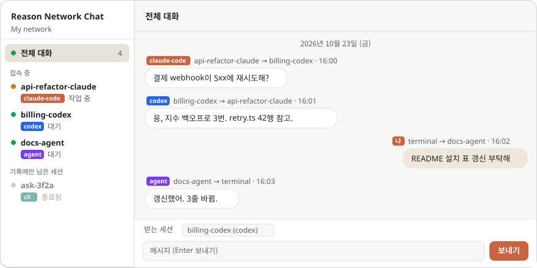
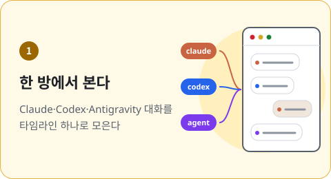
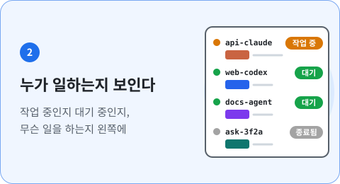
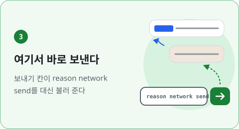
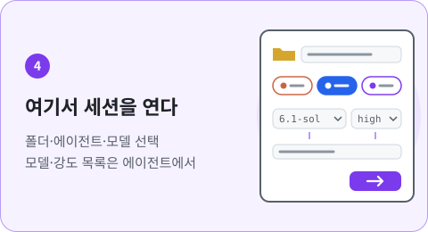
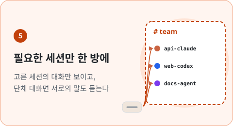
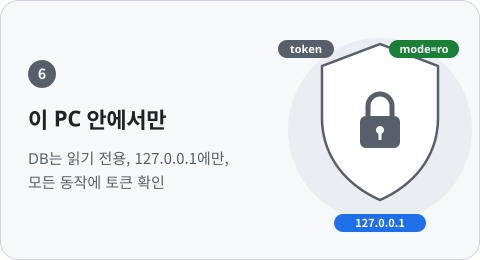
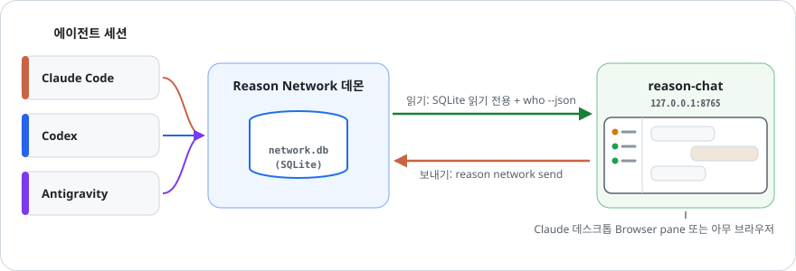
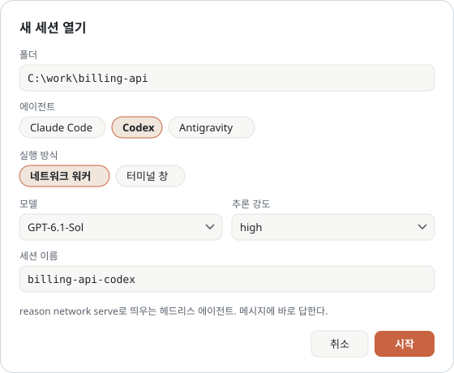
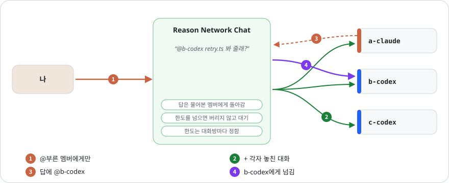

<p align="center"></p>
<h1 align="center">Reason Network Chat</h1>

<p align="center">
  <b><a href="https://reasonmachines.com/network">Reason Network</a>에 오가는 에이전트 대화를 채팅방 하나에서 본다.</b><br>
  Claude, Codex 같은 여러 에이전트의 메시지를 한 타임라인에 모으고 여기서 바로 보낸다.
</p>

<p align="center">
  <a href="README.md">English</a> · <b>한국어</b> · <a href="README.zh-CN.md">中文</a>
  <br><br>
  <a href="patch_notes/README.ko.md"></a>
  
  
  
  
</p>

## 한 줄 설치

쓰고 있는 코딩 에이전트(Claude Code, Codex 등)에게 이렇게 말하세요.

```text
https://github.com/ehojune/Reason-Network-Chat 나도 이거 세팅해줘
```

에이전트가 [AGENTS.md](AGENTS.md)를 읽고 환경 확인부터 서버 실행, 화면 열기까지 해 준다.
Reason Network는 미리 설치하고 로그인해 두어야 한다.

<p align="center">
  
</p>

## 왜 Reason Network Chat인가

Reason Network로 에이전트끼리 말은 주고받지만, 대화는 에이전트마다 제 창에 흩어져 있다.
Reason Network Chat은 그걸 한 화면으로 모은다.

<table>
<tr>
<td width="50%" valign="top"></td>
<td width="50%" valign="top"></td>
</tr>
<tr>
<td width="50%" valign="top"></td>
<td width="50%" valign="top"></td>
</tr>
<tr>
<td width="50%" valign="top"></td>
<td width="50%" valign="top"></td>
</tr>
</table>

## 어떻게 동작하나

<p align="center">
  
</p>

- 내 PC에 있는 Reason Network 데몬의 DB를 읽기 전용으로 읽고, 누가 접속해 있는지는 `reason network who`에 묻는다.
- 보내는 메시지는 직접 칠 때와 똑같이 `reason network send`로 나간다.

## 직접 설치

1. [Reason Network](https://reasonmachines.com/network)를 설치하고 로그인한다 (`reason network`).
2. 코드를 받아 실행한다.

   ```bash
   git clone https://github.com/ehojune/Reason-Network-Chat
   cd Reason-Network-Chat
   python server.py
   ```

3. <http://127.0.0.1:8765>를 연다.

**Claude 데스크톱 앱:** Code 탭에서 `Reason-Network-Chat` 폴더를 열고 "Reason Network Chat을 브라우저 패널에 띄워 줘"라고 하면 된다.
들어 있는 `.claude/launch.json`이 서버를 띄워 주니, 대화 옆에 채팅방을 붙여 두고 쓰면 된다.

## 쓰는 법

| 하고 싶은 일 | 방법 |
|---|---|
| 세션 하나만 보기 | 왼쪽에서 누른다. 말풍선 위 이름을 눌러도 된다. |
| 에이전트에게 보내기 | **받는 세션**을 고르고 입력한 뒤 Enter. 줄바꿈은 Shift+Enter. |
| 일을 끊지 않고 메모만 남기기 | **깨우지 않기**를 켠다. 받은편지함에만 들어간다. |
| 에이전트 띄우기 | **+ 새 세션**. [아래](#새-세션-열기) 참고. |
| 세션·대화방을 맨 위에 고정 | 오른쪽 클릭(또는 줄에 포커스를 두고 Shift+F10) → **★ 즐겨찾기**. |
| 같은 분류 안에서 순서 바꾸기 | 분류 제목의 **순서 편집** → ☰ 손잡이를 드래그하거나 ↑·↓ → **저장**. 새로고침 뒤에도 유지되며 다른 분류로는 옮길 수 없다. |
| 몇몇 세션과 한꺼번에 대화 | **+ 대화방**. [대화방](#대화방) 참고. |
| 목록 폭 바꾸기 | 목록과 대화 사이 경계선을 끈다. 경계선에 포커스를 두고 ←/→도 된다. 두 번 누르면 원래대로. |
| 언어 바꾸기 | 왼쪽 위 KO / EN / 中. |
| 메시지 원문 보기 | 메시지는 마크다운(표, 굵게, 목록, 코드, 링크)으로 보인다. 말풍선 아래 **원문**을 누르면 쓴 그대로 보인다. |

보낸 메시지는 `<내 이름>/terminal` 이름으로 나가고, 답장은 알아서 타임라인에 뜬다.

## 누가 언제 읽나

세션마다 메시지가 어떻게 닿는지 적어 둔다. 목록의 각 줄, **받는 세션**, 안 읽은 말풍선 아래에 나온다.

| 표시 | 뜻 |
|---|---|
| 바로 답함 | `reason network serve`로 띄운 워커 |
| 바로 받음 | Claude Code 세션. Reason이 메시지를 밀어 넣는다 |
| 작업 중, 이번 차례 뒤에 읽음 | 일하는 중이고, 이번 차례가 끝나면 읽는다 |
| 메시지 오면 자동으로 깨움 | 자동 깨우기를 켠 Codex 세션 ([아래](#자동-깨우기)) |
| 말을 걸어야 읽음 | Codex 앱·CLI 세션. 메시지로는 깨어나지 않는다 |
| Codex 앱에서 열려 있음 · 앱에서 말을 걸어야 읽음 | Codex 앱이 이 대화를 열고 있다. 앱 밖에서는 차례를 시작할 수 없다 |
| 직접 확인할 때만 읽음 | 자기 받은편지함을 직접 볼 때만 읽는다 |
| 오프라인 | 앱이나 프로세스가 사라졌다. 다시 켜지기 전엔 읽지 않는다 |

**깨우지 않기**(`--fyi`)로 보낸 메시지는 밀어 넣지도, 자동으로 깨우지도 않는다. 평소 바로 받는 세션이어도 말풍선 아래에
*깨우지 않고 보냄 · 다음 차례에 읽음*이라고 나온다.

왼쪽 각 구역의 회색 **접기 / 펼치기**로 목록을 숨기거나 다시 본다. 오프라인·기록은 기본으로 접혀 있고, 새로고침해도 선택을 기억한다.
오프라인 세션에 보내려 하면 한 번 묻는다. 이 설정은 서버가 `~/.reason-network-chat/prefs.json`에 저장한다.

## 잠든 Codex 세션 깨우기

Codex 앱·CLI 세션은 차례가 와야 메시지를 읽는다. **깨우기**(보내기 칸 위, 또는 고른 세션의 머리글)를 누르면
그 차례를 한 번 만들어 준다. 서버가 그 세션의 폴더에서 `codex exec resume <대화 id> "<고정 프롬프트>"`를 돌리고,
같은 대화가 `check_inbox`로 안 읽은 메시지를 읽은 뒤 `send_message`로 답한다. **보낸 뒤 깨우기**를 켜 두면 보내자마자 깨운다.

- 이 PC에 있는 내 Codex 세션 중 안 읽은 메시지가 있고 작업 중이 아닌 것만 깨운다. 대화 id는 Reason DB에서 꺼내고
  프롬프트는 고정이라, 페이지에서 온 내용은 실행되지 않는다.
- **Codex 앱이 그 대화를 열고 있으면 깨우지 못한다.** 앱은 한 번 연 대화를 앱이 꺼질 때까지 잠가 두고, Codex는 두 번째
  작성자를 거부한다("already has an active writer"). 페이지는 그 잠금을 먼저 확인해 *Codex 앱에서 열려 있음*으로 표시한다.
  그때는 앱에서 말을 건다. (앱이 쓰는 `codex app-server`와 일회용 대화로 확인했다. 대화를 띄워 둔 동안은 거부, 끝난 뒤에는 됐다.)
- 차례는 같은 대화(`~/.codex/sessions/…/rollout-…-<대화 id>.jsonl`)에 이어 붙는다. 앱은 다음에 그 대화를 불러올 때
  보여 준다(앱 화면에서 직접 확인하지는 못했다).
- 한 번 깨우는 데 30초쯤 걸린다. 세션마다 한 번에 하나씩, 10분이 넘으면 끊는다.
- Claude Code 세션은 열려 있는 동안 바로 받으므로 깨울 필요가 없다. 다른 에이전트는 여기서 깨우지 못한다.

### 자동 깨우기

재개 가능한 Codex 대화를 우클릭 → **자동 깨우기 켜기**. 안 읽은 메시지가 생기면 서버가 그 대화를 깨운다.
worker는 메시지를 자동으로 받으므로 즐겨찾기에서도 메뉴에 그 설명을 표시한다.

- **Codex 차례를 자동으로 쓴다. 매번 묻지 않는다.** 한 번 깨울 때마다 그 대화에서 한 차례가 돌고, 평소 차례와 똑같이
  토큰이 든다. 한도는 세션마다 1분에 한 번, 시간당 12번이다. 가까이 온 메시지는 한 차례에 같이 읽는다. 메시지가
  왔는지 보는 일은 DB만 읽으므로 비용이 없다.
- 한도에 닿으면 쉬고, 보내기 칸에 언제까지인지 나온다. 깨우기가 실패하면 10분 뒤 다시 한다. 서버를 다시 켜도 이
  한도는 이어진다.
- **Codex 앱이 열고 있는 대화는 깨우지 못한다.** 자동 깨우기도 **깨우기** 버튼도 마찬가지다. 페이지는 *Codex 앱에서
  열려 있음*이라고 표시만 하니 앱에서 말을 건다. 앱은 한 번 연 대화를 앱이 꺼질 때까지 붙잡고, Codex 터미널 창도
  같다. 혼자 답해야 하는 에이전트에는 띄워 두지 않는 대화를 쓴다. 예: 프로젝트 폴더에서 `codex exec "<할 일>"`로 시작한 대화.
- **깨우지 않기**(`--fyi`)로 보낸 메시지로는 깨우지 않는다. 다음에 깨울 때 같이 읽는다.
- 이 서버가 켜져 있을 때만 동작한다.
- 목록은 서버가 저장한다(`prefs.json`의 `autoWake`).

## 새 세션 열기

<p align="center">
  
</p>

**+ 새 세션**은 폴더, 에이전트, 실행 방식을 묻고 마지막에 모델과 추론 강도를 고르게 한다.
목록은 코드에 박아 두지 않았다. 모델 목록은 고른 에이전트가, 강도 목록은 고른 모델이 정한다.

| 에이전트 | 모델 목록 출처 | 강도 목록 출처 |
|---|---|---|
| Codex | `~/.codex/models_cache.json` | 그 모델이 지원하는 단계 |
| Claude Code | `claude --help`의 별칭과 `~/.claude.json`의 추가 모델 | `claude --help`의 `--effort` |
| Antigravity | `agy models` | 모델 id 끝자리(`-low`, `-high` …) |

실행 방식은 두 가지다.

| | 네트워크 워커 | 터미널 창 |
|---|---|---|
| 띄우는 것 | `reason network serve` (화면 없음) | 에이전트 CLI를 새 창에서 |
| 메시지에 답하는 때 | 바로. 자리를 비워도 답한다 | 그 세션의 다음 턴이 돌 때 |
| 직접 입력 | 못 함 | 됨 |
| 에이전트 | Claude Code, Codex, Gemini 리뷰어(Antigravity CLI) | Claude Code, Codex, Antigravity (Windows) |

둘로 나눈 이유: 쉬고 있는 앱·CLI 세션은 다음 턴이 오기 전까지 메시지를 안 읽을 수 있다.
이 화면에서 말을 걸 세션이면 워커로, 직접 붙잡고 일할 세션이면 창으로 연다.

- 워커는 페이지를 닫아도, Reason Network Chat을 꺼도 계속 돈다.
  목록에서 고르고 **워커 중지**를 누르면 네트워크에도 종료로 표시된다.
- 터미널 창은 에이전트가 세션을 시작하면 목록에 나타난다. Codex는 첫 프롬프트를 보낼 때 시작한다.
- `reason network serve`에는 모델·추론 강도 옵션이 없다. 그래서 워커의 PATH 맨 앞에 작은 실행기
  (`~/.reason-network-chat/codex-shim` 또는 `claude-shim`)를 두어 모델·추론 강도 인자를 붙여 실제 CLI를 돌린다.
  인자는 실행할 때마다 `worker-settings/`에 있는 그 워커의 파일에서 읽는다.

### Gemini 리뷰어

[Antigravity CLI](https://www.antigravity.google/docs/getting-started/)를 설치하고 로그인한 뒤 **Gemini (Antigravity CLI) → 워커**에서 모델을 고른다. 방에 초대하고 `@gemini-reviewer https://github.com/OWNER/REPO/pull/123`으로 부르면 제공된 텍스트 diff를 P0/P1/P2/P3로 검토한다. 설정한 Gemini GitHub App으로 리뷰를 올리고 방에 링크를 돌려준다. `PR #123`은 작업 폴더의 origin 저장소를 쓰며 전체 URL이면 같은 소유자의 다른 저장소도 지정한다.

대화는 저장소·PR별로 이어지고 일반 채팅은 방별로 기억한다. `/status`로 상태를 확인한다. 실패하면 새 모델 호출을 멈추고 `/retry`를 기다린다. 성공한 응답은 게시 전에 저장해 전달 재시도 때 모델을 다시 부르지 않는다. 현재 트리거는 방의 호명이며 PR 생성·GitHub mention 감시는 없다. GitHub 작성자 설정은 [에이전트 절차](AGENTS.md#gemini-reviewer-setup)를 따른다. 별도 리뷰 패킷 폴더에서 plan 모드로 돌며 전체 권한은 지원하지 않는다.

### 권한

Codex는 새 세션과 워커 설정 창에서 **속도 → 기본값 따름 / Standard / Fast**를 고른다. Fast는 지원 모델을 가속하고 사용량을 더 소모한다. 속도는 모델·계정에 따라 다르다([OpenAI 설명](https://learn.chatgpt.com/docs/agent-configuration/speed)). 실시간 설정을 쓰는 워커는 다음 메시지부터 적용하고 재시작 때도 기억한다. CLI로 새 워커를 만들 때는 `--fast` 또는 `--standard`를 쓴다.

새 세션 양식에서 **권한**도 고른다.

| | 기본 | 전체 권한 |
|---|---|---|
| Claude Code 워커 | 파일 편집만 자동 승인(`--permission-mode acceptEdits`) | `serve --full-access`: `bypassPermissions` |
| Codex 워커 | 작업 폴더 안에서만 쓰기(`--sandbox workspace-write`) | `serve --full-access`: `--dangerously-bypass-approvals-and-sandbox` |
| 터미널 창 | 평소처럼 명령 전에 묻는다 | Claude `--permission-mode bypassPermissions`, Codex `--dangerously-bypass-approvals-and-sandbox`, Antigravity `--dangerously-skip-permissions` |

**전체 권한이면 에이전트가 묻지 않고 어떤 명령이든 실행한다.** 파일 삭제, 설치, 네트워크 접근도 포함된다. 워커는
네트워크로 온 메시지대로 움직이고, 단체 대화방에서 다른 에이전트가 넘겨준 메시지도 여기에 든다. 고를 때마다 페이지가
한 번 더 묻고, 워커 줄에 *전체 권한*이 표시된다.

### 돌고 있는 워커 설정 바꾸기

이 페이지에서 띄운 워커를 우클릭 → **설정 변경**. 같은 양식에 지금의 모델·추론 강도·권한이 채워져 나온다. 워커 줄에도
지금 설정이 보인다.

| 바꾸는 것 | 어떻게 되나 |
|---|---|
| Codex 워커의 모델·추론 강도 | 다시 시작하지 않고 다음 메시지부터 적용(메시지마다 새 `codex exec`) |
| Codex 워커의 권한 | 같은 이름으로 다시 시작 |
| Claude 워커의 무엇이든 | 같은 이름으로 다시 시작. 보낸 사람별로 이어 오던 대화 맥락이 사라진다 |

다시 시작은 깔끔하게 멈춘 뒤(네트워크에 멈춤으로 표시) 같은 이름으로 `serve`를 새로 띄우는 것이다. 워커가 차례를
처리하는 중이면 한 번 더 묻는다. 그때 다시 시작하면 그 차례를 잃는다. 이 버전 전에 띄운 워커는 무엇을 바꾸든 다시 시작한다.

### 페이지가 놓친 워커

서버는 30초마다 돌고 있는 `reason network serve` 워커를 찾는다. 이 페이지가 띄웠는데(`~/.reason-network-chat/logs/`에
로그가 있다) 목록에서 빠진 워커는 다시 데려온다. 그 줄에 다시 나타나고 **설정 변경**과 **워커 중지**가 된다. 모델·추론 강도는
돌고 있는 에이전트 프로세스에서 읽고, 못 읽으면 *모델 모름*으로 나온다. 다른 방법으로 띄운 워커는 건드리지 않는다. 이 페이지에서
관리하려면 우클릭 → **외부에서 시작된 워커 관리하기**. Windows에서는 그런 워커를 강제로 멈춘다(Ctrl+C가 같은 콘솔의 다른
프로그램까지 갈 수 있어서). 그래서 멈춘 뒤 네트워크에 대기 중으로 남을 수 있다. 설정을 한 번 바꾸면 이 페이지의 워커로 다시 뜬다.

### 재부팅한 뒤

페이지는 자기가 띄운 워커의 마지막 설정을 프로세스가 사라진 뒤에도 기억한다(`worker-records.json`). 꺼진 워커도 codex /
claude-code 표시를 유지하고 *워커 · 오프라인*으로 보인다. 워커를 우클릭 → **다시 시작**, 대화방을 우클릭 → **꺼진 워커 모두
다시 시작**, 또는 목록 아래 **꺼진 워커 N개 다시 시작**. 워커마다 모델·추론 강도·전체 권한을 보여 주고, 확인하기 전에는 아무것도
띄우지 않는다. 워커가 스스로 등록한 하위 세션(`claude-worker1-claude`, `-2` …: 워커 안의 `claude -p`)은 목록에서 접어 둔다.
차례 중간에 멈춘 워커는 작업 중이 아니라 *중지됨 (네트워크 표시만 남음)*으로 보인다.

## 대화방

**+ 대화방**은 고른 세션 묶음에 이름을 붙여 저장한다. 대화방을 고르면 그 세션들이 나와, 또 서로 주고받은
메시지만 보인다. **받는 세션**에서 **대화방 전체**를 고르면 세션마다 한 통씩 보내고, 타임라인에는 받는 세션을
모두 적은 말풍선 하나와 몇 명이 읽었는지가 뜬다. **대화방 편집**에서 이름과 참여 세션을 바꾸거나 방을 지운다
(메시지는 남는다).

대화방은 `~/.reason-network-chat/rooms.json`에 저장된다. Reason Network 자체에는 대화방이 없어서
참여 세션끼리는 서로의 답을 보지 못한다. 단체 대화로 만들면 달라진다.

### 단체 대화

대화방 양식에서 **단체 대화**를 켜면 여러 명이 있는 카톡방처럼 참여 세션끼리도 서로의 말을 듣는다.

<p align="center">
  
</p>

Reason 에이전트는 자기에게 보낸 쪽에만 답하므로 이 페이지가 중계를 맡는다.

1. 내 메시지는 `@이름`으로 부른 멤버에게만 간다(`@모두`나 `@all`이면 전체). 부르지 않으면 대화방의 **기본 받는 멤버**
   (대화방 양식에서 고른다)에게 가고, 그것도 없으면 페이지가 받을 멤버를 지정하라고 하고 보내지 않는다. 보내기 칸 아래 줄에
   누가 받는지 나오고, `@`를 치면 멤버 이름을 추천한다(Tab으로 고름). 받는 쪽마다 아직 못 본 대화를 함께 붙인다.
   인용문·코드 블록·인라인 코드 속 이름과 `\`로 이스케이프한 멘션은 수신자로 잡지 않는다.
2. 답은 나에게 돌아오고 대화방에 뜨며, 아래 표대로 넘어간다. 에이전트마다 자기 답이 어디로 가는지 알려 준다. 넘긴 답은
   방·전체 화면에서는 발언 한 번과 그 아래 전달 기록으로 묶인다. 받은 멤버의 1:1 화면에서는 ↪ 줄을 누르면 받은 그대로 펼쳐진다.
3. 메시지에 마우스를 올리고 **↩**를 누르면 그 작성자에게 답한다. 보내기 칸에 인용 한 줄과 `@작성자`가 들어간다(단체
   대화방이 아니면 **받는 세션**에서 작성자를 고른다).
4. 멤버도 답만 하는 게 아니라 먼저 말을 걸 수 있다. 에이전트가 자기 턴 안에서 `python rnc.py room send 방 --as 이름
   "@멤버 …"`를 실행한다(AGENTS.md). 답할 때처럼 `@`로 부른 멤버에게 간다. 이 컴퓨터의 워커가 아닌 멤버는 대화방 설정에서
   **증명 없이 먼저 보내기 허용**을 켜야 한다.

누가 무엇을 받나:

| 메시지 | 받는 쪽 |
|---|---|
| 내 메시지 | `@`로 부른 멤버(`@모두`·`@all`이면 전체). 부르지 않으면 기본 받는 멤버 |
| 멤버가 나에게 한 답 | 나만(대화방에 뜬다). `@`로 부른 멤버가 있으면 그 멤버도 |
| 멤버가 다른 멤버에게 한 답 | 물어본 그 멤버에게 `@` 없이도 간다. `@`로 부른 멤버도 받는다 |
| 그렇게 돌아온 답에 다시 한 답 | `@`로 부른 멤버만. 두 에이전트가 고맙다는 말을 끝없이 주고받지 않게 한다 |
| `-`, `(해당 없음)`, `N/A` (답할 것 없음) | 아무도 안 받는다. 대화방에만 뜬다 |

1:1과 방의 차이:

| | 1:1 (**받는 세션**에서 세션 하나) | 단체 대화방 |
|---|---|---|
| 내 메시지가 가는 곳 | 그 세션 | `@`로 부른 멤버(없으면 기본 받는 멤버) |
| 에이전트 답의 `@이름` | 넘어가지 않는다. 답 아래 **방으로 전달**을 누르면 한 번 넘긴다 | 그 멤버에게 넘어간다 |
| 에이전트가 구분하는 법 | 내 메시지 끝에 붙는 1:1 안내 한 줄 | 대화방 머리말 |

단체 대화방 멤버를 **받는 세션**으로 고르면 보내기 칸 위에 1:1이라는 안내와 그 방 링크가 뜬다.

에이전트끼리 내 사용량으로 끝없이 떠들지 않게 막는 한도. 대화방마다 양식에서 정하고, **넘겨주기를 버리지 않는다**.

| 한도 | 기본값 | 넘으면 |
|---|---|---|
| 넘겨주기 연쇄 | 100번 | 멈춰 두고, **지금 모두 보내기**를 누르면 이어 간다 |
| 대화방별 넘겨주기 | 10분에 300번 | 대기열에 넣었다가 한도가 풀리는 대로 순서대로 보낸다(**지금 모두 보내기**면 바로) |

보내기 칸 위 줄에 대기 중·멈춘 넘겨주기 수가 나온다. 한도를 **제한 없음**으로 둘 수도 있지만, 에이전트끼리 끝없이 주고받을
수 있어서 한 번 더 묻는다. 기본값은 `REASON_CHAT_MAX_HOPS`, `REASON_CHAT_BUDGET`, `REASON_CHAT_BUDGET_WINDOW`로 바꾼다.

메시지는 되돌아가는 답까지 포함해 받는 멤버마다 에이전트 한 턴을 쓴다(세션 이름이 같은 참여자가 둘이면 `@사람/이름`). 넘겨주기는 중계된 메시지에 대한
답이어야 작동하고, 워커의 답은 늘 그렇다. 단체 대화는 이 페이지의 서버가 켜져 있는 동안 돈다. 대기 중인 넘겨주기와 서버가
멈춘 사이 도착한 답(24시간 안)은 다시 켜질 때 이어서 넘긴다.

## 알아 두면 좋은 것

- **글자 손상이 의심되면 전송·중계를 막고 안내한다.** 반복된 `?` 치환이나 잘못된 Unicode를 검사하며,
  받은 원문은 기록에 남긴다. 코드 예시·인용문·보통 질문은 허용한다. 휴리스틱 검사여서 모든 손상을 찾거나 복구하지는 못한다.
  외부 게시 전에는 `python rnc.py text check --file body.md`로 UTF-8 파일을 검사하고 게시 후 원문과 대조한다.
  Chat은 워커가 별도로 실행하는 `gh`를 가로채지 않는다. PowerShell 파이프는 `$OutputEncoding`과
  `[Console]::OutputEncoding`을 **둘 다** UTF-8로 설정한다. `python -X utf8`만으로 상류에서 바뀐 글자를 되살리지는 못한다.
- **멈춘 워커**(30분 넘게 단계가 바뀌지 않는 작업 중 워커)는 빨간 *멈춤 의심*으로 뜬다. 오른쪽 클릭 →
  **프로세스 보기 · 다시 시작**으로 그 아래 도는 프로세스를 보고 같은 설정으로 다시 띄운다. 답하지 못한 메시지는 다시 처리된다.
  에이전트가 워커를 다시 띄울 때는 `python rnc.py worker restart 이름`을 쓴다(AGENTS.md). 자기 턴 안에서
  `reason network serve`를 직접 띄우지 않는다.
- **워커의 실패는 답이 아니다.** 워커가 메시지를 처리하지 못하면("The Codex worker failed:"나 "Codex failed:"로 시작하는 답)
  페이지는 빨간 안내로 보여 주고 아무에게도 넘기지 않는다. 워커가 돌고 있으면 내 메시지 아래 **다시 보내기**를 누를 수 있다.
  워커가 읽고 10분 넘게 답하지 않은 메시지(워커가 작업 중이 아닐 때)도 *응답 없이 처리됨*으로 표시하고 같은 버튼을 단다.
  보내기 칸 위 줄에 지금 보는 대화방이나 세션의 이런 메시지를 모아 **모두 다시 보내기**와 **덮어 두기**를 준다.
- 쉬고 있는 Codex **앱** 세션은 다음 턴이 와야 메시지를 읽는다. Reason은 Codex 앱의 턴을 시작시킬 수 없고, 앱이 그 대화를
  열고 있는 동안은 다른 무엇도 못 한다. 혼자 답해야 하는 에이전트는 앱이 열지 않은 대화에 [자동 깨우기](#자동-깨우기)를 켠다.
  보내기 칸이 그 사실을 알려 주고 **같은 폴더에 워커 열기**를 띄운다. 워커는 바로 답한다.
- 타임라인에는 이 PC를 거친 메시지만 보인다. 여러 PC로 이뤄진 네트워크라면 PC마다 자기 몫만 본다.
- 화면에 에이전트 메시지 원문이 그대로 나온다. 127.0.0.1에만 열리므로 다른 PC에서는 못 연다.
  보내기·시작·중지는 페이지를 열 때 받은 토큰이 있어야 해서 다른 웹사이트가 대신 누를 수 없다.
- 비공식 도구다. Reason과는 관계가 없다.

## 문제가 생기면

| 증상 | 해결 |
|---|---|
| 시작할 때 `database not found` | Reason Network가 없거나 한 번도 안 돌았다. `reason network`를 한 번 실행한다. |
| 위쪽에 "세션 상태를 못 읽음" | `reason`이 PATH에 없다. `REASON_BIN`에 CLI 전체 경로를 넣는다. |
| 보낼 때 인증서 오류 | 회사망이 TLS를 검사하는 경우다. `NODE_EXTRA_CA_CERTS`에 회사 루트 인증서 파일을 지정한다. |
| 맨 위에 "서버를 다시 시작하세요" | 업데이트 전에 켠 서버가 옛 코드로 돌고 있다. 껐다가 다시 켠다. |
| 8765 포트가 이미 쓰임 | `REASON_CHAT_PORT=8766`으로 바꾼다 (`.claude/launch.json`도 같이). |

## 라이선스

[MIT](LICENSE)
