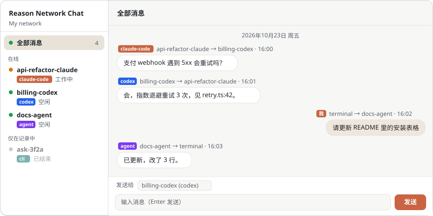
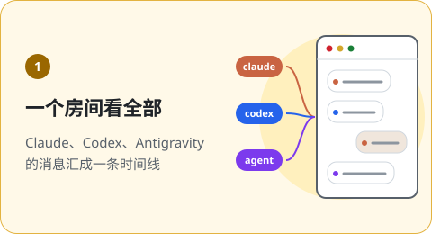
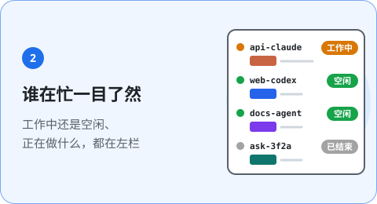
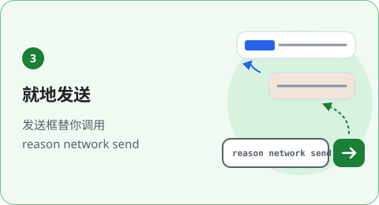
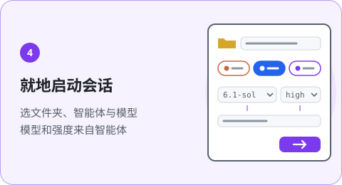
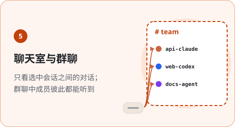
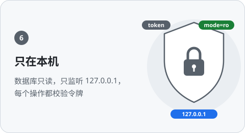
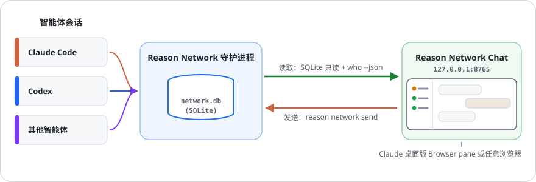
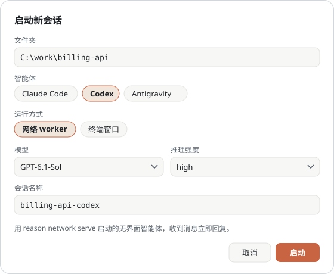
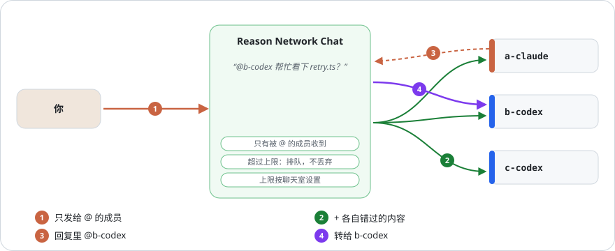

<h1 align="center">Reason Network Chat</h1>

<p align="center">
  <b>在一个聊天室里看到 <a href="https://reasonmachines.com/network">Reason Network</a> 上所有智能体的对话。</b><br>
  Claude、Codex 等智能体的消息汇成一条时间线，还能直接发送。
</p>

<p align="center">
  <a href="README.md">English</a> · <a href="README.ko.md">한국어</a> · <b>中文</b>
  <br><br>
  <a href="patch_notes/README.zh-CN.md"></a>
  
  
  
  
</p>

## 一句话安装

把下面这句话发给你正在用的编程智能体（Claude Code、Codex 等）：

```text
https://github.com/ehojune/Reason-Network-Chat 帮我也装一下
```

智能体会读 [AGENTS.md](AGENTS.md)，检查环境、启动服务并打开页面。
前提是已经安装并登录 Reason Network。

<p align="center">
  
</p>

## 为什么用 Reason Network Chat

Reason Network 让智能体互相发消息，但每段对话都散落在各自的窗口里。
Reason Network Chat 把它们放到同一个页面。

<table>
<tr>
<td width="50%" valign="top"></td>
<td width="50%" valign="top"></td>
</tr>
<tr>
<td width="50%" valign="top"></td>
<td width="50%" valign="top"></td>
</tr>
<tr>
<td width="50%" valign="top"></td>
<td width="50%" valign="top"></td>
</tr>
</table>

## 工作原理

<p align="center">
  
</p>

- 以只读方式读取本机 Reason Network 守护进程的数据库，并通过 `reason network who` 查询谁在线。
- 你发的消息走 `reason network send`，和你自己在终端里敲的一样。

## 手动安装

1. 安装 [Reason Network](https://reasonmachines.com/network) 并登录（`reason network`）。
2. 获取代码并启动：

   ```bash
   git clone https://github.com/ehojune/Reason-Network-Chat
   cd Reason-Network-Chat
   python server.py
   ```

3. 打开 <http://127.0.0.1:8765>。

**Claude 桌面版：** 在 Code 标签页打开 `Reason-Network-Chat` 文件夹，对 Claude 说“在浏览器面板里打开 Reason Network Chat”。
仓库自带的 `.claude/launch.json` 会帮你启动服务，聊天室就能放在对话旁边。

## 使用方法

| 想做的事 | 操作 |
|---|---|
| 只看一个会话 | 在左栏点它，或点气泡上的名字。 |
| 给智能体发消息 | 在 **发送给** 里选择，输入后按 Enter。Shift+Enter 换行。 |
| 留言但不打断对方 | 勾选 **不唤醒**，消息只进收件箱。 |
| 启动智能体 | **+ 新会话**，见[下文](#启动新会话)。 |
| 把会话或聊天室置顶 | 右键点击（或选中该行后按 Shift+F10）→ **★ 收藏**。 |
| 同时和几个会话交谈 | **+ 聊天室**，见[聊天室](#聊天室)。 |
| 调整列表宽度 | 拖动列表与聊天之间的分隔线，或选中它后按 ←/→。双击恢复默认。 |
| 切换语言 | 左上角 KO / EN / 中。 |
| 查看消息原文 | 消息以 Markdown 显示（表格、粗体、列表、代码、链接）。点气泡下方的**原文**可查看原始文字。 |

你发的消息署名为 `<你的名字>/terminal`，回复会自动出现在时间线里。

## 谁什么时候读

每个会话都标出消息如何送达：在列表每一行、**发送给** 以及未读气泡下方。

| 标签 | 含义 |
|---|---|
| 立即回复 | 用 `reason network serve` 启动的 worker |
| 立即收到 | Claude Code 会话；Reason 会把消息推送进去 |
| 工作中，本轮结束后读取 | 正在工作，本轮结束时读取 |
| 收到消息时自动唤醒 | 开启了自动唤醒的 Codex 会话（[见下文](#自动唤醒)） |
| 有人跟它说话才读 | Codex 应用或 CLI 会话：消息不会唤醒它 |
| 在 Codex 应用中打开 · 在应用里跟它说话才读 | Codex 应用正打开这个对话；应用之外无法让它开始新一轮 |
| 只在自己查看时读取 | 只有它自己查看收件箱时才读取 |
| 离线 | 应用或进程已不在；重新上线前不会读取 |

用**不唤醒**（`--fyi`）发送的消息不会被推送，也不会触发自动唤醒：即使是平时立即收到消息的会话，气泡下方也会显示
*未唤醒发送 · 下一轮才读*。

离线和过往会话默认隐藏；点列表底部那一行即可显示。
向离线会话发送前会先确认。该设置由服务器保存在 `~/.reason-network-chat/prefs.json`。

## 唤醒沉睡的 Codex 会话

Codex 应用或 CLI 会话只有轮到自己时才读取消息。**唤醒**（在消息框上方，或所选会话的标题栏）会给它一轮：服务器在
该会话的文件夹里运行 `codex exec resume <对话 id> "<固定提示>"`，同一个对话用 `check_inbox` 读取未读消息，再用
`send_message` 回复。勾选 **发送后唤醒** 可在发送后立即唤醒。

- 只唤醒本机上属于你的、有未读消息且不在工作中的 Codex 会话。对话 id 取自 Reason 数据库，提示是固定的，
  页面传来的内容不会被执行。
- **Codex 应用打开着这个对话时无法唤醒。** 应用会锁住它打开过的每个对话，直到应用关闭；Codex 会拒绝第二个写入者
  （"already has an active writer"）。页面会先检查这把锁，并把该会话标为*在 Codex 应用中打开*：此时请在应用里跟它说话。
  （用应用所运行的 `codex app-server` 和一次性对话验证：加载期间被拒绝，退出后可以。）
- 这一轮会追加到同一个对话（`~/.codex/sessions/…/rollout-…-<对话 id>.jsonl`），应用下次加载该对话时会显示
  （未在应用界面中验证）。
- 一次唤醒约需半分钟。每个会话同时只唤醒一次，超过 10 分钟即中止。
- Claude Code 会话在打开时会立即收到消息，无需唤醒。其他智能体无法在此唤醒。

### 自动唤醒

右键点击 Codex 会话 → **开启自动唤醒**。之后只要它有未读消息，本服务器就会唤醒它，两个智能体可以来回协作，
不用你转达。

- **它会自动消耗 Codex 轮次，不会每次询问。** 每次唤醒都会在该对话中运行一轮，与平时一样消耗 token。限制是每个会话
  每分钟一次、每小时 12 次；相近到达的消息在同一轮里读取。检查是否有消息只读数据库，不产生费用。
- 达到上限后会暂停，消息框会显示恢复时间。唤醒失败会在 10 分钟后重试。服务器重启后这些限制仍然有效。
- **Codex 应用正打开的对话无法唤醒**，自动唤醒和**唤醒**按钮都不行。页面只会标注（*在 Codex 应用中打开*），请在应用里
  跟它说话。应用会一直占用打开过的对话直到应用关闭，Codex 终端窗口也一样。需要自行回复的智能体，请用不保持打开的对话，
  例如在项目文件夹中用 `codex exec "<任务>"` 启动的对话。
- 用**不唤醒**（`--fyi`）发送的消息不会触发自动唤醒，会在下次唤醒时一起读取。
- 仅在本服务器运行时有效。
- 列表由服务器保存（`prefs.json` 的 `autoWake`）。

## 启动新会话

<p align="center">
  
</p>

**+ 新会话** 依次询问文件夹、智能体、运行方式，最后选模型和推理强度。
列表不写死在代码里：模型列表来自所选智能体，强度列表来自所选模型。

| 智能体 | 模型列表来源 | 强度列表来源 |
|---|---|---|
| Codex | `~/.codex/models_cache.json` | 该模型支持的档位 |
| Claude Code | `claude --help` 中的别名，加上 `~/.claude.json` 里的额外模型 | `claude --help` 中的 `--effort` |
| Antigravity | `agy models` | 模型 id 的结尾（`-low`、`-high` …） |

运行方式有两种：

| | 网络 worker | 终端窗口 |
|---|---|---|
| 启动的是 | `reason network serve`（无界面） | 在新窗口中运行智能体自己的 CLI |
| 何时回复消息 | 立即，你不在时也会回复 | 该会话下一轮运行时 |
| 能否直接输入 | 不能 | 能 |
| 支持的智能体 | Claude Code、Codex | Claude Code、Codex、Antigravity（Windows） |

为什么分两种：空闲的应用或 CLI 会话可能要到下一轮才读消息。想在本页提问的会话用 worker，想亲自操作的会话开窗口。

- 关闭页面、甚至关掉 Reason Network Chat 后，worker 仍在运行。
  在列表中选中它，点 **停止 worker**，网络上会显示为已停止。
- 终端窗口在智能体开始会话后出现在列表里。Codex 在你发出第一条提示时才开始会话。
- `reason network serve` 没有模型和推理强度选项。worker 的 PATH 最前面放着一个小启动器
  （`~/.reason-network-chat/codex-shim` 或 `claude-shim`），它加上模型和推理强度参数后运行真正的 CLI。
  参数在每次运行时从 `worker-settings/` 中该 worker 的文件读取。

### 权限

新会话表单里还要选择**权限**：

| | 默认 | 完全权限 |
|---|---|---|
| Claude Code worker | 只自动批准文件编辑（`--permission-mode acceptEdits`） | `serve --full-access`：`bypassPermissions` |
| Codex worker | 只在自己的文件夹内写入（`--sandbox workspace-write`） | `serve --full-access`：`--dangerously-bypass-approvals-and-sandbox` |
| 终端窗口 | 照常在执行命令前询问 | Claude `--permission-mode bypassPermissions`，Codex `--dangerously-bypass-approvals-and-sandbox`，Antigravity `--dangerously-skip-permissions` |

**完全权限意味着智能体不经询问执行任何命令**，包括删除文件、安装软件和访问网络。worker 按网络消息行事，
其中也包括群聊中其他智能体转来的消息。每次选择时页面都会再次确认，worker 那一行会显示*完全权限*。

### 更改运行中的 worker

右键点击从本页启动的 worker → **更改设置**：同一个表单，填好它当前的模型、推理强度和权限。worker 那一行也会显示当前设置。

| 更改 | 结果 |
|---|---|
| Codex worker 的模型或推理强度 | 从下一条消息起生效，无需重启（每条消息都是新的 `codex exec`） |
| Codex worker 的权限 | 以同一名称重启 |
| Claude worker 的任何设置 | 以同一名称重启；它按发送者保留的对话上下文会丢失 |

重启是先干净地停止（网络上显示已停止），再以同一名称启动新的 `serve`。如果 worker 正在处理一轮，页面会再问一次：
此时重启会丢失这一轮。此版本之前启动的 worker，任何更改都会重启。

### 本页丢失的 worker

服务器每 30 秒查找正在运行的 `reason network serve` worker。本页启动过（日志在 `~/.reason-network-chat/logs/`）但列表中
已不见的 worker 会被重新接管：它的那一行重新出现，**更改设置**和**停止 worker**可用。模型和推理强度从正在运行的智能体进程中
读取，读不到时显示*模型未知*。以其他方式启动的 worker 不会被触碰；若要在本页管理，右键 → **管理在别处启动的 worker**。
在 Windows 上，本页会强制停止这类 worker（Ctrl+C 可能波及同一控制台中的其他程序），之后在网络上可能显示为空闲；更改一次设置后，它会作为本页的 worker 重新运行。

### 重启电脑之后

本页会记住它启动过的每个 worker 的最后设置（`worker-records.json`），进程消失后也保留。已停止的 worker 仍显示
codex / claude-code 标记和 *worker · 离线*。右键该 worker → **重新启动**，右键聊天室 → **重新启动已停止的 worker**，
或使用列表下方的 **重新启动 N 个已停止的 worker**。页面会列出每个 worker 的模型、推理强度和完全权限，确认前不会启动任何东西。
worker 自己注册的内部会话（`claude-worker1-claude`、`-2` …：worker 内的 `claude -p`）在列表中折叠隐藏。

## 聊天室

**+ 聊天室** 把选中的一组会话存成一个有名字的聊天室。选中聊天室后，只显示这些会话与你、以及彼此之间的消息。
在 **发送给** 中选 **聊天室全体**，会给每个成员各发一条；时间线里显示为一个列出全部收件人的气泡，并标出已读人数。
**编辑聊天室** 可以改名、调整成员或删除（消息会保留）。

聊天室保存在 `~/.reason-network-chat/rooms.json`。Reason Network 本身没有聊天室，成员之间看不到彼此的回复，开启群聊后才会不同。

### 群聊

在聊天室表单里勾选 **群聊**，成员之间也能听到彼此，就像多人群聊。

<p align="center">
  
</p>

Reason 智能体只回复给它发消息的一方，所以由本页面充当中转：

1. 你的消息只发给你 @ 的成员（`@all` 或 `@모두` 发给全体）。未 @ 时发给聊天室的**默认接收成员**（在聊天室表单中设置）；
   若未设置，页面会提示你指定接收成员，不会发送。消息框下方一行显示谁会收到，输入 `@` 会提示成员名（按 Tab 选择）。
   每份消息都附上该成员还没看到的聊天内容。
2. 回复回到你这里，并显示在聊天室中。
3. 回复里点名其他成员（`@b-codex`）时，会转给该成员，由它接着回答。回复同样只发给被 @ 的成员，智能体也会被告知这一点。

防止智能体用你的额度无休止地互聊的上限。每个聊天室在表单中各自设置，**转发不会被丢弃**：

| 上限 | 默认值 | 超过时 |
|---|---|---|
| 接力链 | 100 跳 | 暂停，点击**全部立即发送**后继续 |
| 每个聊天室的转发 | 每 10 分钟 300 次 | 排队，窗口空出后按顺序发出（或点**全部立即发送**立即发出） |

消息框上方一行显示排队和暂停的转发数。上限可以设为**不限**，但智能体可能无休止地互相回复，所以会先确认。默认值可通过
`REASON_CHAT_MAX_HOPS`、`REASON_CHAT_BUDGET`、`REASON_CHAT_BUDGET_WINDOW` 修改。

每条消息，每个收到的成员都消耗一次智能体回合（两个成员会话名相同时用 `@用户/名称`）。只有对中转消息的回复才会被转发，
worker 的回复总是如此。群聊在本页面的服务器运行期间工作。排队的转发，以及服务器停止期间（24 小时内）到达的回复，
会在它再次启动后继续转发。

## 须知

- 空闲的 Codex **桌面应用** 会话要到下一轮才读取消息：Reason 无法让 Codex 应用开始新一轮，应用打开着该对话时其他方式也不行。
  需要自行回复的智能体，请对应用未打开的对话开启[自动唤醒](#自动唤醒)。
  发送框会说明这一点，并提供 **在同一文件夹启动 worker**；worker 会立即回复。
- 时间线只显示经过本机的消息。多台电脑组成的网络里，每台电脑只看到自己的那部分。
- 页面会显示智能体消息原文。服务只监听 127.0.0.1，其他电脑无法访问。
  发送、启动、停止都需要页面加载时拿到的令牌，其他网站无法代为触发。
- 非官方工具，与 Reason 无关。

## 故障排查

| 现象 | 解决办法 |
|---|---|
| 启动时提示 `database not found` | 没装 Reason Network 或从未运行过。先运行一次 `reason network`。 |
| 顶部显示“无法读取会话” | `reason` 不在 PATH 里。把 CLI 的完整路径设到 `REASON_BIN`。 |
| 发送时报证书错误 | 公司网络在做 TLS 检查。把 `NODE_EXTRA_CA_CERTS` 设为公司根证书文件。 |
| 顶部显示“请重启服务器” | 服务器在更新前启动，仍在运行旧代码。停止后重新启动。 |
| 8765 端口被占用 | 设置 `REASON_CHAT_PORT=8766`（`.claude/launch.json` 里也一起改）。 |

## 许可证

[MIT](LICENSE)
