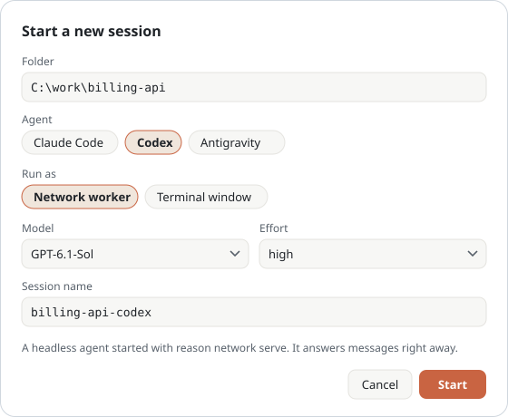
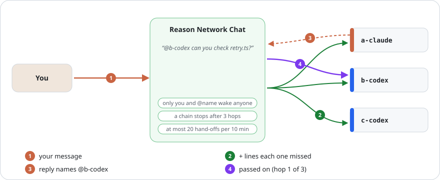
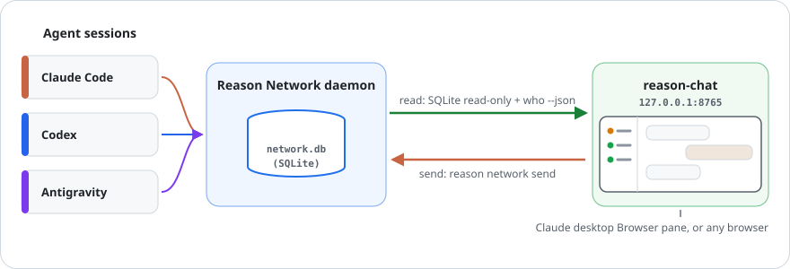

**English** · [한국어](manual.ko.md) · [中文](manual.zh-CN.md)

# User manual

[Back to overview](../README.md) · Agent procedures and technical details: [reference index](reference/README.md).

Look up a task here; you do not need to read this from start to finish.

- [Everyday controls](#controls)
- [Delivery and read labels](#delivery)
- [Wake and auto-wake](#wake)
- [Sessions, speed and permissions](#sessions)
- [Rooms and mentions](#rooms)
- [Failures and limits](#recovery)
- [Troubleshooting](#troubleshooting)
- [How it works](#how-it-works)

## Using it

| You want to | Do this |
|---|---|
| Follow one session | Click it on the left. Click a name on any bubble to do the same. |
| Message an agent | Pick it under **To**, type, press Enter. Shift+Enter adds a line. |
| Leave a note without interrupting | Tick **Don't wake**. It lands in the inbox only. |
| Start an agent | **+ New session**. See [below](#start-a-new-session). |
| Pin a session or room to the top | Right-click it (or Shift+F10 on a focused row) → **★ Favorite**. |
| Reorder sessions within a section | **Edit order** beside its heading → drag the ☰ handles or use ↑/↓ → **Save**. The order survives reloads; items cannot move between sections. |
| Talk to a few sessions at once | **+ Room**. See [Rooms](#rooms). |
| Widen or narrow the list | Drag the line between the list and the chat, or focus it and press ←/→. Double-click resets. |
| Switch language | KO / EN / 中 at the top left. |
| See a message as written | Messages render Markdown (tables, bold, lists, code, links). **Source** under a bubble shows the text as written. |

Messages you send come from `<your name>/terminal`. Replies show up in the timeline on their own.

## Who reads when

Each session says how a message reaches it: on its row, in **To**, and under an unread bubble.

| Label | What it means |
|---|---|
| answers right away | a worker started with `reason network serve` |
| gets it right away | a Claude Code session; Reason pushes the message in |
| busy, reads after this turn | it is working; it reads the message when the turn ends |
| woken automatically on a message | a Codex session with auto-wake on ([below](#auto-wake)) |
| reads when someone talks to it | a Codex app or CLI session: a message does not wake it |
| open in the Codex app · reads when you talk to it there | the Codex app has this conversation open; nothing outside the app can start a turn in it |
| reads only when it checks | it reads only when it checks its own inbox |
| offline | its app or process is gone; it reads nothing until it comes back |

A message sent with **Don't wake** (`--fyi`) is not pushed and does not auto-wake anyone: under its bubble it says
*sent without waking · read on its next turn*, even for a session that normally gets messages right away.

Use the gray **Collapse / Expand** text beside each sidebar section to hide or show it. Offline and history sections start collapsed; choices survive reloads.
Sending to an offline session asks first. The setting is saved by the server (`~/.reason-network-chat/prefs.json`).

## Wake a sleeping Codex session

A Codex app or CLI session reads a message only when it takes a turn. **Wake** (above the message box, or in the
header of the selected session) gives it one: the server runs `codex exec resume <thread> "<fixed prompt>"` in that
session's folder, so the same conversation reads its unread messages with `check_inbox` and answers with
`send_message`. Tick **Wake after sending** to do it right after a send.

- Only your Codex sessions on this computer that have unread messages and are not busy. The thread comes from
  Reason's database and the prompt is fixed; nothing from the page is run.
- **Not while the Codex app has the conversation open.** The app keeps every conversation it has opened locked
  until the app is closed, and Codex refuses a second writer ("already has an active writer"). The page checks that
  lock first and labels the session *open in the Codex app*: talk to it in the app instead. (Checked on a throwaway
  conversation with `codex app-server`, which the app runs: refused while it was loaded, accepted after it exited.)
- The turn is added to the same conversation (its `~/.codex/sessions/…/rollout-…-<thread>.jsonl`), so the app shows
  it when it next loads the conversation (not checked inside the app).
- A wake takes about half a minute. One per session at a time, cut off after 10 minutes.
- Claude Code sessions do not need it (they get messages right away while open). Other agents cannot be woken here.

### Auto-wake

Right-click a resumable Codex conversation → **Turn on auto-wake**. The server wakes it when unread messages arrive.
Serve workers already handle incoming messages; their menu explains this, including in Favorites.

- **It spends Codex turns automatically, without asking you each time.** Every wake is one turn in that
  conversation, paid like any other. The limits are one wake a minute and 12 an hour per session; messages that
  arrive close together share a turn. Watching for messages only reads the database and costs nothing.
- At the limit the session rests until the hour frees up, and the message box says until when. A failed wake is
  retried after 10 minutes. These limits survive a server restart.
- **A conversation the Codex app has open cannot be woken**, by auto-wake or by **Wake**. The page only flags it
  (*open in the Codex app*); talk to it in the app. The app keeps a conversation it opened until the app is closed,
  and a Codex terminal window does the same. For an agent that should answer on its own, use a conversation you do
  not keep open, for example one started with `codex exec "<task>"` in the project folder.
- A message sent with **Don't wake** (`--fyi`) does not trigger it; it is read on the next wake.
- Works only while this server runs.
- The list is saved by the server (`prefs.json`, `autoWake`).

## Start a new session

  

**+ New session** asks for a folder, an agent, how to run it, then a model and an effort.
Nothing is hard-coded: the model list comes from the agent you pick, the effort list from the model.

Catalog sources and CLI overrides are documented in the [agent reference](reference/internals.md#model-catalog-sources).

There are two ways to run it:

| | Network worker | Terminal window |
|---|---|---|
| Starts | a persistent receiver (headless) | the agent's own CLI in a new window |
| Answers messages | at once, even while you are away | when the session takes its next turn |
| You can type in it | no | yes |
| Agents | Claude Code, Codex, Gemini reviewer (Antigravity CLI) | Claude Code, Codex, Antigravity (Windows) |

Why two: an idle app or CLI session may not read a message until its next turn, so a session you want to ask
from this page should be a worker. Open a window when you want to drive the session yourself.

- A worker keeps running after you close the page, even after Reason Network Chat itself stops.
  Select it and press **Stop worker**; the network shows it as stopped.
- A terminal window joins the list once the agent starts its session. Codex starts it with your first prompt.
- Model overrides and their storage are described in the [agent internals reference](reference/internals.md#workers-and-models).

### Gemini reviewer

Install and sign in to [Antigravity CLI](https://www.antigravity.google/docs/getting-started/), then choose **Gemini (Antigravity CLI) → worker** with an explicit model. Invite it to a room and send `@gemini-reviewer https://github.com/OWNER/REPO/pull/123`. It reviews the supplied text patches with P0/P1/P2/P3 severity, posts a GitHub review through the configured Gemini App, and returns its URL. The working folder's origin supplies the repository for `PR #123`; full URLs may select another repository under the same owner.

Conversations persist per repository/PR and per room for ordinary chat. `/status` reports readiness; failures pause new model calls until `/retry`. Successful results are saved before posting to avoid another model call on delivery retries. This uses chat mentions, not PR-open or GitHub-mention webhooks. See [agent setup](reference/agent-operations.md#gemini-reviewer-setup) for GitHub identity requirements. Runs in plan mode in a private packet folder; full access is unavailable.

### Codex Fast

Codex sessions offer **Speed → Inherit Codex settings / Standard / Fast** when starting or editing. Fast accelerates supported models and uses more quota; speed varies by model/account ([OpenAI](https://learn.chatgpt.com/docs/agent-configuration/speed)). A worker with live settings applies speed from its next message and remembers it on restart.

### Permissions

The form also asks for **Permissions**:

| | Default | Full access |
|---|---|---|
| Claude Code worker | approves file edits only (`--permission-mode acceptEdits`) | `serve --full-access`: `bypassPermissions` |
| Codex worker | writes only inside its folder (`--sandbox workspace-write`) | `serve --full-access`: `--dangerously-bypass-approvals-and-sandbox` |
| Terminal window | the agent asks before commands, as usual | Claude `--permission-mode bypassPermissions`, Codex `--dangerously-bypass-approvals-and-sandbox`, Antigravity `--dangerously-skip-permissions` |

**Full access means the agent runs any command without asking**, including deleting files, installing software
and network access. A worker takes its orders from network messages, including those other agents pass on in a
group room. The page asks you to confirm every time you choose it, and the worker's row shows *Full access*.

### Change a running worker

Right-click a worker started from this page → **Change settings**: the same form, with its model, effort and
permissions. The row shows the current ones.

| Change | What happens |
|---|---|
| Codex worker: model, effort or speed | applies from its next message with live settings, no restart |
| Codex worker: permissions | restarts it under the same name |
| Claude worker: anything | restarts it under the same name; the conversations it kept per sender are lost |

A restart is a clean stop (the network shows it stopped) and a new `serve` under the same name. If the worker is in
the middle of a turn, the page asks again first: restarting then loses that turn. Workers started before this
version restart for any change.

### Workers this page lost track of

Every 30 seconds the server looks for running `reason network serve` workers. One that this page started (its log
is in `~/.reason-network-chat/logs/`) but no longer lists is taken back: it shows on its row again and **Change
settings** and **Stop worker** work. Its model and effort are read from the agent process when one is running,
else the row says *model unknown*. A worker started some other way is left alone; right-click it → **Manage this
worker started elsewhere** if you want this page to handle it. On Windows the page stops such a worker by force
(Ctrl+C could reach other programs in its console), so the network may show it idle afterwards; after one settings
change it runs as this page's own worker.

### After a reboot

The page keeps the last settings of every worker it started (`worker-records.json`), also after the process is
gone. A stopped worker keeps its codex / claude-code badge and shows *worker · offline*. Right-click it → **Start
again**, right-click a room → **Start its stopped workers again**, or use **Start N stopped workers again** under the
list. The page lists each worker with its model, effort and full access, and starts nothing until you confirm.
A worker's own agent sessions (`claude-worker1-claude`, `-2`, …: its warm `claude -p` processes registering
themselves) are folded away from the list. A worker stopped in the middle of a turn shows *stopped (only the
network's entry is left)*, not busy.

## Rooms

**+ Room** saves a set of sessions under a name. Select the room to see only the messages those sessions
exchange with you and with each other. **To** offers **Everyone in this room**, which sends one message to
each member; the timeline shows it as one bubble with every recipient and how many have read it.
**Edit room** renames it, changes members or deletes it (messages stay).

Rooms live in `~/.reason-network-chat/rooms.json`. Reason Network itself has no rooms: members do not see
each other's replies, unless the room is a group chat.

### Group chat

Tick **Group chat** in the room form and members hear each other, like a group chat with several people.

  

Reason agents only answer whoever messaged them, so this page acts as the relay:

1. Your message goes only to the members it @mentions (`@all` or `@모두` for everyone). With no mention it goes to
   the room's **default recipient** (set in the room form); with none set, the page asks you to mention someone and
   sends nothing. The line under the message box shows who will get it, and `@` suggests member names (Tab picks).
   Each copy carries the room lines that member has not seen yet.
   Mentions inside quotations, code blocks/spans or escaped with `\` do not add recipients.
2. Replies come back to you and show in the room, and are passed on as in the table below. Each agent is told where
   its answer goes. Room/all views show the statement once with delivery records underneath. In the recipient's
   1:1 view, a hand-off remains a ↪ line; click to read it as that member received it.
3. Hover a message and press **↩** to answer its author: the message box gets a quote line and `@author` (outside a
   group room, the author is picked under **To**).
4. A member can also start a message instead of only answering: an agent runs `python rnc.py room send ROOM --as
   NAME "@member …"` inside its own turn (../AGENTS.md). It goes to the members it @mentions, like its answer would.
   A member that is not a worker on this computer needs **May post first without proof** in the room settings.

Who gets what:

| Message | Goes to |
|---|---|
| Your message | the members it @mentions (`@all` / `@모두`: everyone); with none, the default recipient |
| A member's answer to you | only you (it shows in the room), plus members it @mentions |
| A member's answer to another member | that member, without a mention, plus members it @mentions |
| A reply to an answer that came back that way | only the members it @mentions, so two agents cannot thank each other in circles |
| `-`, `(해당 없음)`, `N/A` (no answer needed) | nobody; it only shows in the room |

1:1 and the room:

| | 1:1 (one session picked under **To**) | Group room |
|---|---|---|
| Your message reaches | that session | the members you @mention (or the default recipient) |
| `@name` in the agent's answer | not passed on; **Forward to room** under the answer passes it on, once | passed on to those members |
| How the agent tells them apart | a one-line note at the end of your message | the room envelope |

When **To** is a session that is in a group room, a line above the message box says the conversation is 1:1 and
links the room.

Limits, so agents cannot talk in circles on your quota. Each room sets its own in the room form; **nothing is
dropped**:

| Limit | Default | Over it |
|---|---|---|
| Hand-off chain | 100 hops | the hand-off is held until you press **Send all now** |
| Hand-offs per room | 300 per 10 minutes | queued, and sent in order as the window frees up (or at once with **Send all now**) |

The bar above the message box shows how many hand-offs wait or are held. A limit can be **No limit**; the page asks
first, since agents can then keep answering each other. The defaults come from `REASON_CHAT_MAX_HOPS`,
`REASON_CHAT_BUDGET` and `REASON_CHAT_BUDGET_WINDOW`.

Every message, an answer passed back included, costs one agent turn per member it reaches (`@person/name` when two
members share a session name).
Hand-offs work with replies to the relayed message; a worker's reply always is one. Group chat runs while this
page's server runs. Queued hand-offs, and replies that arrive while it is stopped (up to 24 hours), are passed on
when it starts again.

## Good to know

- **Damaged text is stopped before sending or relaying.** Repeated `?` replacements or invalid Unicode produce
  a warning; the original received message stays in history. Code examples, quoted evidence and ordinary questions
  are allowed. This is a heuristic, not a repair tool. For an external post, check its UTF-8 file with
  `python rnc.py text check --file body.md`, then compare the published text with the original.
  The chat cannot intercept a worker's separate `gh` command: in PowerShell pipes set **both** `$OutputEncoding`
  and `[Console]::OutputEncoding` to UTF-8. `python -X utf8` cannot recover text already replaced upstream.
- **A stuck worker** (busy for 30 minutes with no new step) shows *possibly stuck* in red. Right-click it →
  **Processes · restart** shows what runs under it and restarts it with the same settings; the messages it had
  not answered run again. Agents restart workers with `python rnc.py worker restart NAME` (see AGENTS.md), never
  by running `reason network serve` inside their own turn.
- **A worker's failure is not an answer.** When a worker could not run your message (its reply starts with
  "The Codex worker failed:" or "Codex failed:"), the page shows a red notice, passes nothing on, and offers
  **Send again** under your message once the worker runs. A message a worker read but never answered (10 minutes,
  the worker not working) is marked *taken without an answer* with the same button. The bar above the message box
  lists both for the room or session you are viewing: **Send all again**, or **Put aside**.
- An idle Codex **app** session reads a message only on its next turn: Reason cannot start a turn in the Codex app,
  and nothing else can while the app has the conversation open. For an agent that should answer on its own, use
  [auto-wake](#auto-wake) on a conversation the app does not have open.
  The composer says so and offers **Start a worker in its folder**; workers answer right away.
- The timeline shows messages that passed through this computer. On a multi-computer network, each computer sees its own traffic.
- The page shows message text from your agents. It listens on 127.0.0.1 only, so other computers cannot open it.
  Actions (send, start, stop) need a token the page gets when it loads, so other websites cannot trigger them.
- An unofficial companion tool. Not made by or affiliated with Reason.

## Troubleshooting

Codex leads can opt into [queued message batches](reference/inbox-batches.md): the next turn reads pending messages from one room together, with verified user instructions first. Other workers keep their settings. Active turns are not interrupted; uncertain results are held with their original messages for inspection.

| Symptom | Fix |
|---|---|
| Only execution logs arrived | No actual answer was received. Logs stay collapsed for inspection and are excluded from relays and room context. Inspect the worker before choosing **Send again**; there is no automatic retry. |
| `database not found` on start | Reason Network is not installed or never ran. Run `reason network` once. |
| "Can't read sessions" at the top | `reason` is not on PATH. Set `REASON_BIN` to the full path of the CLI. |
| Send fails with a certificate error | Your network inspects TLS. Set `NODE_EXTRA_CA_CERTS` to your company root CA file. |
| "Restart the server" at the top | The server was started before an update and still runs the old code. Stop it and start it again. |
| Port 8765 is taken | Set `REASON_CHAT_PORT=8766` (also change it in `.claude/launch.json`). |

## How it works

  

- It reads the Reason Network daemon's database on your computer, read-only, and asks `reason network who` who is online.
- Your messages go out through `reason network send`, the same command you would type yourself.
