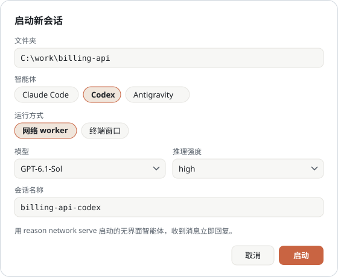
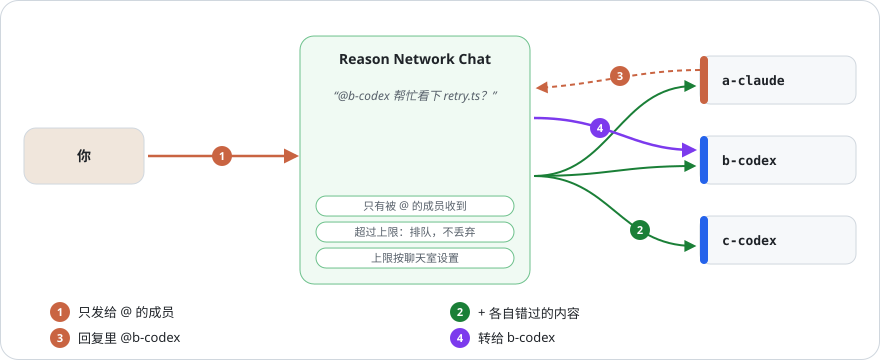
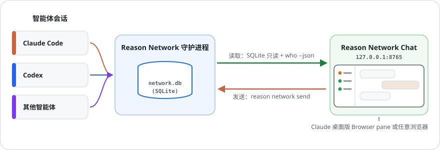

[English](manual.md) · [한국어](manual.ko.md) · **中文**

# 用户手册

[返回项目介绍](../README.zh-CN.md) · 智能体操作步骤与技术说明见[参考索引](reference/README.zh-CN.md)。

按需查阅，无需从头读完。首次安装请先看 README。

- [日常操作](#controls)
- [收件与已读标记](#delivery)
- [唤醒与自动唤醒](#wake)
- [会话、速度与权限](#sessions)
- [聊天室与提及](#rooms)
- [失败处理与限制](#recovery)
- [故障排查](#troubleshooting)
- [工作原理](#how-it-works)

## 使用方法

| 想做的事 | 操作 |
|---|---|
| 只看一个会话 | 在左栏点它，或点气泡上的名字。 |
| 给智能体发消息 | 在 **发送给** 里选择，输入后按 Enter。Shift+Enter 换行。 |
| 留言但不打断对方 | 勾选 **不唤醒**，消息只进收件箱。 |
| 启动智能体 | **+ 新会话**，见[下文](#启动新会话)。 |
| 把会话或聊天室置顶 | 右键点击（或选中该行后按 Shift+F10）→ **★ 收藏**。 |
| 调整同一分类内的顺序 | 分类标题旁的**调整顺序** → 拖动 ☰ 手柄或使用 ↑/↓ → **保存**。刷新后保留顺序，不可跨分类移动。 |
| 同时和几个会话交谈 | **+ 聊天室**，见[聊天室](#聊天室)。 |
| 调整列表宽度 | 拖动列表与聊天之间的分隔线，或选中它后按 ←/→。双击恢复默认。 |
| 切换语言 | 左上角 KO / EN / 中。 |
| 查看消息原文 | 消息以 Markdown 显示（表格、粗体、列表、代码、链接）。点气泡下方的**原文**可查看原始文字。 |

你发的消息署名为 `<你的名字>/terminal`，回复会自动出现在时间线里。

## 谁什么时候读

每个会话都标出消息如何送达：在列表每一行、**发送给** 以及未读气泡下方。

| 标签 | 含义 |
|---|---|
| 立即回复 | 用 `reason network serve` 启动的 worker |
| 立即收到 | Claude Code 会话；Reason 会把消息推送进去 |
| 工作中，本轮结束后读取 | 正在工作，本轮结束时读取 |
| 收到消息时自动唤醒 | 开启了自动唤醒的 Codex 会话（[见下文](#自动唤醒)） |
| 有人跟它说话才读 | Codex 应用或 CLI 会话：消息不会唤醒它 |
| 现有 Codex 对话被占用 · 可投递到队列 | 应用或 CLI 占用对话；空闲时可通过唤醒向队列投递 |
| 只在自己查看时读取 | 只有它自己查看收件箱时才读取 |
| 离线 | 应用或进程已不在；重新上线前不会读取 |

用**不唤醒**（`--fyi`）发送的消息不会被推送，也不会触发自动唤醒：即使是平时立即收到消息的会话，气泡下方也会显示
*未唤醒发送 · 下一轮才读*。

点击侧栏各分区旁的灰色 **收起 / 展开** 文字即可隐藏或显示列表。离线和过往会话默认收起，刷新后仍保留选择。
向离线会话发送前会先确认。该设置由服务器保存在 `~/.reason-network-chat/prefs.json`。

## 唤醒沉睡的 Codex 会话

**唤醒**请求同一个 Codex 对话检查收件箱并回复。勾选**发送后唤醒**可在发送后请求。

- 仅限本机上属于你的、有未读消息的 Codex 对话；工作中则等待。
- 应用或 CLI 占用的空闲对话接收一次原生队列投递。未被占用的对话沿用现有无界面唤醒。
- **队列已接收**只是投递回执；**已确认原始消息已读**需要原始消息的已读标记。
- 接收后 10 分钟仍未读，或崩溃、超时导致投递不确定时，会暂停且不重发。新消息也等待原批次确认已读。
- 已完成的消息 ID 在重启或手动唤醒后也不会重发。不支持 queue 时显示明确错误。

### 自动唤醒

右键点击可恢复的 Codex 对话 → **开启自动唤醒**，也支持应用或 CLI 占用的对话。
worker 已自动接收消息，无需额外开关。

- 每次唤醒消耗 Codex 轮次和 token；检查消息只读取数据库，不消耗 token。
- 每个会话每分钟一次、每小时 12 次，重启后仍有效。相近消息合为一批。
- **不唤醒**（`--fyi`）消息不会触发自动唤醒。不确定的队列投递不会自动重试。
- 服务器运行时有效；开启列表保存于 `prefs.json` 的 `autoWake`。

最多可同时运行 12 个受管理的 worker，包括审查器。

## 启动新会话

  

**+ 新会话** 依次询问文件夹、智能体、运行方式，最后选模型和推理强度。
列表不写死在代码里：模型列表来自所选智能体，强度列表来自所选模型。

模型目录来源与 CLI 参数见[智能体参考](reference/internals.md#model-catalog-sources)。

运行方式有两种：

| | 网络 worker | 终端窗口 |
|---|---|---|
| 启动的是 | 常驻接收器（无界面） | 在新窗口中运行智能体自己的 CLI |
| 何时回复消息 | 立即，你不在时也会回复 | 该会话下一轮运行时 |
| 能否直接输入 | 不能 | 能 |
| 支持的智能体 | Claude Code、Codex、Gemini 审查器（Antigravity CLI） | Claude Code、Codex、Antigravity（Windows） |

为什么分两种：空闲的应用或 CLI 会话可能要到下一轮才读消息。想在本页提问的会话用 worker，想亲自操作的会话开窗口。

- 关闭页面、甚至关掉 Reason Network Chat 后，worker 仍在运行。
  在列表中选中它，点 **停止 worker**，网络上会显示为已停止。
- 终端窗口在智能体开始会话后出现在列表里。Codex 在你发出第一条提示时才开始会话。
- 模型参数的传递方式和存储位置见[智能体实现参考](reference/internals.md#workers-and-models)。

### Gemini 审查器

1. 选择 **新会话 → Gemini (Antigravity CLI) → worker**，从已安装 CLI 提供的选项中选择模型和强度，并命名（例如 `gemini-argon-reviewer`）。
2. 在**编辑群聊**中选择该名称并保存。运行中的接收器在首次对话前即可显示，Gemini 徽章为紫色。名称已存在时，请查找已有接收器，不要重复创建。
3. 发送 `@gemini-argon-reviewer https://github.com/OWNER/REPO/pull/123` 并说明审查重点。其他群成员也可这样调用；仅在 GitHub 中提及不会启动它。
4. 核对返回的审查链接、作者、实际审查的 head 和 P0/P1/P2/P3。结合复现与 CI 判断，不要自动采纳所有建议。这不能代替全仓库检查或执行测试。

使用 `@gemini-argon-reviewer /status` 查询状态；解决失败原因后，用 `@gemini-argon-reviewer /retry` 重试保留的请求。额度有限时每次只提交一个 PR，不要重复呼叫。可用模型取决于 CLI 和账户。

安装并登录 [Antigravity CLI](https://www.antigravity.google/docs/getting-started/)，选择 **Gemini (Antigravity CLI) → worker** 和明确的模型。邀请它加入群聊，发送 `@gemini-reviewer https://github.com/OWNER/REPO/pull/123`，即可按 P0/P1/P2/P3 审查所提供的文本补丁，通过配置的 Gemini GitHub App 发布审查并回传链接。`PR #123` 使用工作目录的 origin 仓库；完整链接可选择同一所有者的其他仓库。

对话按仓库和 PR 持久保存，普通聊天按群聊保存。`/status` 查询状态；失败后暂停新模型调用，等待 `/retry`。成功结果在发布前保存，重试投递无需再次调用模型。目前只处理聊天提及，不监听 PR 创建或 GitHub 提及。GitHub 身份配置见[智能体设置](reference/agent-operations.md#gemini-reviewer-setup)。在独立资料目录中以 plan 模式运行，不支持完全权限。

### Codex Fast

Codex 在新会话和 worker 设置中提供 **速度 → 继承 Codex 设置 / Standard / Fast**。Fast 加速支持的模型并消耗更多用量；速度取决于模型和账户（[OpenAI 说明](https://learn.chatgpt.com/docs/agent-configuration/speed)）。支持实时设置的 worker 从下一条消息起应用，并在重启时保留。

### 权限

新会话表单里还要选择**权限**：

| | 默认 | 完全权限 |
|---|---|---|
| Claude Code worker | 只自动批准文件编辑（`--permission-mode acceptEdits`） | `serve --full-access`：`bypassPermissions` |
| Codex worker | 只在自己的文件夹内写入（`--sandbox workspace-write`） | `serve --full-access`：`--dangerously-bypass-approvals-and-sandbox` |
| 终端窗口 | 照常在执行命令前询问 | Claude `--permission-mode bypassPermissions`，Codex `--dangerously-bypass-approvals-and-sandbox`，Antigravity `--dangerously-skip-permissions` |

**完全权限意味着智能体不经询问执行任何命令**，包括删除文件、安装软件和访问网络。worker 按网络消息行事，
其中也包括群聊中其他智能体转来的消息。每次选择时页面都会再次确认，worker 那一行会显示*完全权限*。

### 更改运行中的 worker

右键点击从本页启动的 worker → **更改设置**：同一个表单，填好它当前的模型、推理强度和权限。worker 那一行也会显示当前设置。

| 更改 | 结果 |
|---|---|
| Codex worker 的模型、推理强度或速度 | 支持实时设置时从下一条消息起生效，无需重启 |
| Codex worker 的权限 | 以同一名称重启 |
| Claude worker 的模型或推理强度 | 保留每位发送者的对话 ID；首次迁移需要空闲且收件队列为空，之后的修改在下一轮生效 |
| Claude worker 的权限 | 重启；尚未迁移的 worker 会丢失内存中的对话 |

重启是先干净地停止（网络上显示已停止），再以同一名称启动新的 `serve`。如果 worker 正在处理一轮，页面会再问一次：
此时重启会丢失这一轮。此版本之前启动的 worker，任何更改都会重启。

### 本页丢失的 worker

服务器每 30 秒查找正在运行的 `reason network serve` worker。本页启动过（日志在 `~/.reason-network-chat/logs/`）但列表中
已不见的 worker 会被重新接管：它的那一行重新出现，**更改设置**和**停止 worker**可用。模型和推理强度从正在运行的智能体进程中
读取，读不到时显示*模型未知*。以其他方式启动的 worker 不会被触碰；若要在本页管理，右键 → **管理在别处启动的 worker**。
在 Windows 上，本页会强制停止这类 worker（Ctrl+C 可能波及同一控制台中的其他程序），之后在网络上可能显示为空闲；更改一次设置后，它会作为本页的 worker 重新运行。

### 重启电脑之后

本页会记住它启动过的每个 worker 的最后设置（`worker-records.json`），进程消失后也保留。已停止的 worker 仍显示
codex / claude-code 标记和 *worker · 离线*。右键该 worker → **重新启动**，右键聊天室 → **重新启动已停止的 worker**，
或使用列表下方的 **重新启动 N 个已停止的 worker**。页面会列出每个 worker 的模型、推理强度和完全权限，确认前不会启动任何东西。
worker 自己注册的内部会话（`claude-worker1-claude`、`-2` …：worker 内的 `claude -p`）在列表中折叠隐藏。
在一轮中途被停止的 worker 显示为*已停止（网络上仅剩记录）*，而不是工作中。

## 聊天室

**+ 聊天室** 把选中的一组会话存成一个有名字的聊天室。选中聊天室后，只显示这些会话与你、以及彼此之间的消息。
在 **发送给** 中选 **聊天室全体**，会给每个成员各发一条；时间线里显示为一个列出全部收件人的气泡，并标出已读人数。
**编辑聊天室** 可以改名、调整成员或删除（消息会保留）。

聊天室保存在 `~/.reason-network-chat/rooms.json`。Reason Network 本身没有聊天室，成员之间看不到彼此的回复，开启群聊后才会不同。

### 群聊

在聊天室表单里勾选 **群聊**，成员之间也能听到彼此，就像多人群聊。

  

Reason 智能体只回复给它发消息的一方，所以由本页面充当中转：

1. 你的消息只发给你 @ 的成员（`@all` 或 `@모두` 发给全体）。未 @ 时发给聊天室的**默认接收成员**（在聊天室表单中设置）；
   若未设置，页面会提示你指定接收成员，不会发送。消息框下方一行显示谁会收到，输入 `@` 会提示成员名（按 Tab 选择）。
   每份消息都附上该成员还没看到的聊天内容。
   引用、代码块、行内代码和用 `\` 转义的 @ 名称不会增加接收人。
2. 回复回到你这里，显示在聊天室中，并按下表转发。每个智能体都会被告知自己的回答发往哪里。聊天室和全部视图只显示一次发言，
   下方列出转发记录；接收成员的 1:1 视图仍显示 ↪ 行，点击即可查看收到的原文。
3. 鼠标移到消息上并点 **↩** 即可回复其作者：消息框会加上一行引用和 `@作者`（不在群聊时，在 **发送给** 中选中作者）。
4. 成员也可以先发言，而不只是回答：智能体在自己的回合内运行 `python rnc.py room send 聊天室 --as 名称 "@成员 …"`
   （见 AGENTS.md），与回答一样发给被 @ 的成员。不是本机 worker 的成员需在聊天室设置中勾选 **允许无需证明先发言**。

谁收到什么：

| 消息 | 发给 |
|---|---|
| 你的消息 | 被 @ 的成员（`@all` / `@모두`：全体）；未 @ 时发给默认接收成员 |
| 成员对你的回答 | 只有你（显示在聊天室中），以及其中被 @ 的成员 |
| 成员对另一成员的回答 | 自动回到提问的成员（无需 @），以及其中被 @ 的成员 |
| 对这样自动回来的回答的回复 | 只发给被 @ 的成员，避免两个智能体无休止地互相道谢 |
| `-`、`(해당 없음)`、`N/A`（无需回答） | 谁都不发；只显示在聊天室中 |

1:1 与聊天室的区别：

| | 1:1（在 **发送给** 中选一个会话） | 群聊 |
|---|---|---|
| 你的消息发给 | 该会话 | 被 @ 的成员（未 @ 时发给默认接收成员） |
| 智能体回答里的 `@名称` | 不转发；点回答下方的 **转发到聊天室** 可转发一次 | 转给这些成员 |
| 智能体如何分辨 | 你的消息末尾附一行 1:1 说明 | 聊天室信封 |

在 **发送给** 中选了群聊成员时，消息框上方会提示这是 1:1 对话，并附上聊天室链接。

防止智能体用你的额度无休止地互聊的上限。每个聊天室在表单中各自设置，**转发不会被丢弃**：

| 上限 | 默认值 | 超过时 |
|---|---|---|
| 接力链 | 100 跳 | 暂停，点击**全部立即发送**后继续 |
| 每个聊天室的转发 | 每 10 分钟 300 次 | 排队，窗口空出后按顺序发出（或点**全部立即发送**立即发出） |

消息框上方一行显示排队和暂停的转发数。上限可以设为**不限**，但智能体可能无休止地互相回复，所以会先确认。默认值可通过
`REASON_CHAT_MAX_HOPS`、`REASON_CHAT_BUDGET`、`REASON_CHAT_BUDGET_WINDOW` 修改。

每条消息（包括自动回到提问者的回答），每个收到的成员都消耗一次智能体回合（两个成员会话名相同时用 `@用户/名称`）。只有对中转消息的回复才会被转发，
worker 的回复总是如此。群聊在本页面的服务器运行期间工作。排队的转发，以及服务器停止期间（24 小时内）到达的回复，
会在它再次启动后继续转发。

## 须知

直接提问含 `?` 或 `？`，且只收到 `-` 等确认时，页面标记为未回答。由用户决定再次询问还是搁置，不会自动重发。

- **疑似损坏的文字会被阻止发送或转发并显示提示。** 检查重复的 `?` 替换和无效 Unicode；收到的原文仍保留在历史中。
  代码示例、引用证据和普通问句允许通过。此检查是启发式的，不能检测或修复所有损坏。
  对外发布前，可用 `python rnc.py text check --file body.md` 检查 UTF-8 文件，发布后再与原文核对。
  Chat 无法拦截 worker 单独运行的 `gh`。PowerShell 管道需要将 `$OutputEncoding` 和 `[Console]::OutputEncoding`
  **都**设为 UTF-8；`python -X utf8` 无法恢复上游已被替换的文字。
- **卡住的 worker**（忙碌 30 分钟以上且步骤没有变化）显示红色*疑似卡住*。右键 → **查看进程 · 重新启动** 可查看其下运行的
  进程，并以相同设置重新启动；未回答的消息会被再次处理。智能体重启 worker 时用 `python rnc.py worker restart 名称`
  （见 AGENTS.md），不要在自己的回合里直接运行 `reason network serve`。
- **worker 的失败不是回答。** worker 无法处理你的消息时（回复以 "The Codex worker failed:" 或 "Codex failed:" 开头），
  页面显示红色提示，不转发给任何人；worker 运行时，可在你的消息下点 **再次发送**。worker 已读却 10 分钟未回答
  （且不在工作中）的消息标为*已读但未回答*，同样带此按钮。消息框上方一行汇总当前聊天室或会话中的这些消息，
  提供 **全部再次发送** 和 **搁置**。
- 空闲的 Codex **桌面应用** 会话要到下一轮才读取消息：Reason 无法让 Codex 应用开始新一轮，应用打开着该对话时其他方式也不行。
  需要自行回复的智能体，请对应用未打开的对话开启[自动唤醒](#自动唤醒)。
  发送框会说明这一点，并提供 **在同一文件夹启动 worker**；worker 会立即回复。
- 时间线只显示经过本机的消息。多台电脑组成的网络里，每台电脑只看到自己的那部分。
- 页面会显示智能体消息原文。服务只监听 127.0.0.1，其他电脑无法访问。
  发送、启动、停止都需要页面加载时拿到的令牌，其他网站无法代为触发。
- 非官方工具，与 Reason 无关。

## 故障排查

Codex 负责人可启用[待处理消息批次](reference/inbox-batches.md)：下一轮合并同一聊天室的待处理消息，先读已验证的用户指令。其他 worker 的设置不变，不中断正在运行的轮次。结果不确定时保留原文并暂停，供检查。

Codex shim 会暂停结果不确定的请求，并在发送前保存完整回复。使用[恢复命令](reference/internals.md#pitfalls)检查；它不会自动重放任务。

可选的 capacity probe 在发送请求前用独立的一次性提示选择模型。在 worker shim 设置 JSON 中将 `capacity_probe` 设为 `{"enabled": true, "fallback_model": "MODEL", "fallback_effort": "EFFORT"}`，值须来自 Codex runtime catalog。启用时需要 Python 3.11 或更高版本。结果最多缓存一小时；probe 中断或结果不确定时会暂停请求。

| 现象 | 解决办法 |
|---|---|
| 启动时提示 `database not found` | 没装 Reason Network 或从未运行过。先运行一次 `reason network`。 |
| 只收到了运行日志，没有实际回答 | 日志折叠保留，不会转发给其他成员或加入群聊上下文。先检查 worker 状态，必要时选择**重新发送**；不会自动重试。 |
| 顶部显示“无法读取会话” | `reason` 不在 PATH 里。把 CLI 的完整路径设到 `REASON_BIN`。 |
| 发送时报证书错误 | 公司网络在做 TLS 检查。把 `NODE_EXTRA_CA_CERTS` 设为公司根证书文件。 |
| 顶部显示“请重启服务器” | 服务器在更新前启动，仍在运行旧代码。停止后重新启动。 |
| 8765 端口被占用 | 设置 `REASON_CHAT_PORT=8766`（`.claude/launch.json` 里也一起改）。 |

## 工作原理

  

- 以只读方式读取本机 Reason Network 守护进程的数据库，并通过 `reason network who` 查询谁在线。
- 你发的消息走 `reason network send`，和你自己在终端里敲的一样。

交接实现任务时使用[任务所有权检查](reference/assignments.md)。它拒绝重叠范围、过期版本以及仍在工作或有排队请求的交接。负责人和 worker 必须使用 CLI 检查；普通聊天不会预留文件。
批次回复关联所有已验证的输入。未确认送达的已保存回复可在**批次投递记录**中查看，查看不会发送，批次请求也不能重发。没有关联回复的请求可能已在别处处理，请先检查原文。
